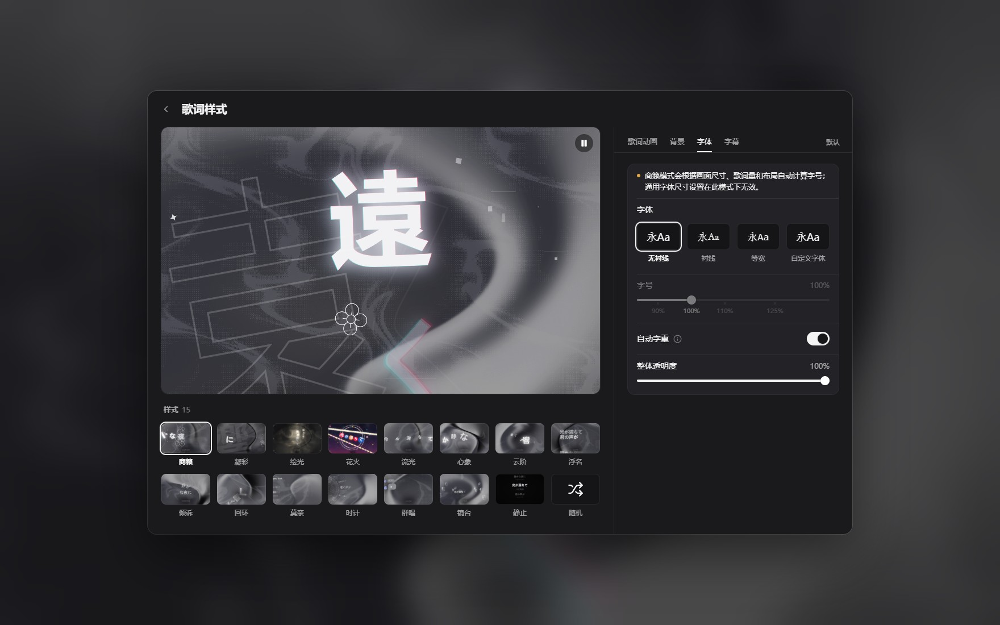
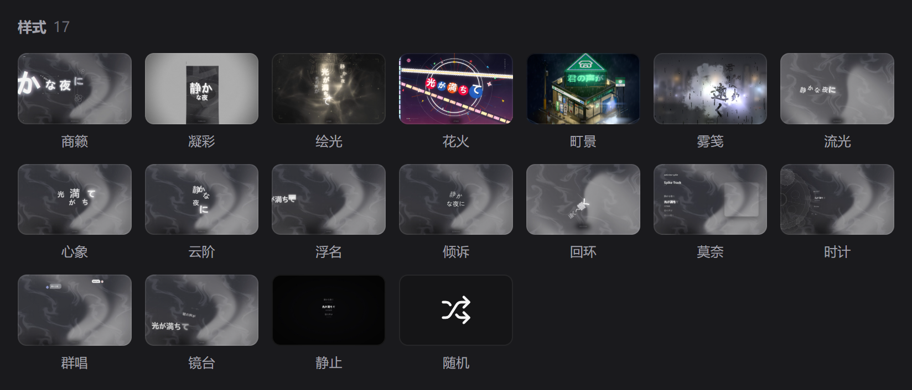

# spw-folia — Folia lyric visualizer for Salt Player for Windows

Brings the [Folia](https://github.com/chthollyphile/folia-major) lyric visualizer into **Salt Player
for Windows (SPW)**: the `Folia` entry in the mini player's **More** menu opens a borderless
fullscreen mode where 17 lyric styles render live against whatever SPW is playing — and the lyrics
can also be floated straight over your desktop.

[](https://github.com/azkbzxf/spw-folia/releases)
[](LICENSE)
[](#compatibility)
[](https://azkbzxf.github.io/spw-folia/)

[中文](README.md) | **English**

<p align="center"></p>

## What the plugin does

- **17 lyric styles, one click away** — Sonnet · Tempera · Lumiere · Hanabi · Machi · Nebbia ·
  Classic · Cadenza · Partita · Fume · Tilt · Claddagh · Monet · Pendolo · Cappella · Diorama ·
  Still. Each one is Folia's original look: transitions, glow, per-character timing and animated
  backgrounds. Check several of them into a random pool and each song gets a different style
  (no repeats back to back); the dice button on the playback bar rerolls on the spot.
- **In sync with the music** — per-character lyrics, translation subtitles, play / pause / seek /
  speed all follow the player, and the visuals react to the music.
- **A playback bar you can actually use** — play / pause, previous / next, drag to seek,
  shuffle / repeat, plus a queue panel you can click to jump around. You can also **click the
  picture itself**: the middle pauses, the left and right thirds step through the queue.
  That layer never gets in the picture's own way — 「町景」 still rotates when you drag it, zooms
  with the wheel and pans on right-drag, so a drag stays a drag and a click stays a click.
- **What you see in settings is what you get** — the "Lyric style" window shows the player page
  itself on the left (real song, real lyrics, real background), so every slider reflects live.
- **Custom fonts and subtitles** — import a font pack (`.ttf` / `.otf` / `.woff` / `.woff2`, up to
  50 MB each) or pick from system fonts; weight, size, overall opacity, subtitle style and
  background, upcoming-lyric blur and more are all adjustable.
- **Colours follow the cover art** — theme, background and accent colours derive from the current
  track's cover and change as the song changes.
- **Float the lyrics over your desktop** — the button panel at the bottom right of the player page
  turns on **transparent playback page**: the window becomes genuinely transparent and leaves only
  lyrics and effects over the desktop or other windows, ideal for streaming or OBS overlays. The row
  below, **mouse passthrough**, lets you keep working while the lyrics stay on screen.
- **Shortcuts to get back** — SPW's shortcut manager offers two re-bindable actions, `Toggle
  transparent playback page` (default **Ctrl+Alt+G**) and `Toggle transparent playback page + mouse
  passthrough` (default **Ctrl+Alt+Shift+G**). **Ctrl+Alt+B** restores opacity from the
  transparent state.
- **More than one way in** — open / close from the mini player's **More → Folia**, or by
  right-clicking the tray icon after minimising. Multi-monitor aware; **Alt + left-click** drags the
  window across screens.
- **Diagnose it yourself when something is wrong** — **Mods → Config → Support & feedback → Report
  a problem** (the life-buoy button at the top right of the player page does the same) checks the
  runtime environment item by item and names whatever is missing; when everything is present it
  opens a pre-filled feedback page and selects the log file in Explorer. See
  [troubleshooting](docs/runtime-requirements.md).
- **Style thumbnails are not redrawn every time** — the 17 tiles in the lyric-style panel are
  cached on disk after the first draw, so reopening the panel is near-instant. On a weaker machine,
  **Config → Player page → 歌词样式预览动画** turns the animation off: each tile then draws a plain
  glyph and far less work is done when the panel opens.
- **No network, no uploads** — there is no HTTP server and no external request; data only travels
  between the plugin and its local helper process. Playback state, current track, lyrics and cover
  art are read, never written.

## Screenshots

<p align="center">
  
  
</p>
<p align="center">
  
  
</p>
<div align="center"><sub>Fullscreen page · Lyric style settings · Transparent playback page · 17 lyric styles</sub></div>

> Want the whole tour at once? The [**promo site**](https://azkbzxf.github.io/spw-folia/) has the
> scrolling demo, every style at full size, and a recorded walkthrough — all footage rendered by the
> plugin itself.

## Install and use

1. **Install the plugin**, either way:
   - download the latest `.spmod` from [Releases](https://github.com/azkbzxf/spw-folia/releases);
   - or subscribe on the [Steam Workshop](https://steamcommunity.com/sharedfiles/filedetails/?id=3825012802)
     (the Steam build installs itself after subscribing).
2. SPW → **Settings → Plugins / Workshop → Import plugin**, pick the file and enable it. Grant the
   **class-transform** ("hook") permission when asked — the menu entry needs it; also grant
   **key-bindings** ("shortcuts") for the transparency shortcuts. You can grant a missing one later
   on the plugin's permission page and restart SPW.
3. Restart SPW when the plugin manager asks.
4. Play a song, open the mini player's **More** (…) menu → **Folia**.

The first run opens the lyric-style settings window; afterwards the visualizer opens directly
(the gear at the top right opens settings; ESC closes settings first and then the window). Settings
are stored in SPW's plugin data directory.

To float the lyrics over the desktop: the button panel at the bottom right of the player page →
turn on **transparent playback page**; turn on **mouse passthrough** as well when you want to keep
using the computer, and press **Ctrl+Alt+B** to restore opacity.

<p align="center"></p>

## Compatibility

**Requires**: Windows 10/11 x64 · **Salt Player for Windows 1.19.0 or newer** (1.19.0 / 1.19.2 /
1.19.3 are all accepted) · WebView2 Runtime (bundled on Windows 11; install "Microsoft Edge WebView2
Runtime" on Windows 10) · .NET Framework 4.8 (bundled since Windows 10 1903).

The full dependency matrix and crash troubleshooting live in
[docs/runtime-requirements.md](docs/runtime-requirements.md).

### Known limitations

- **No smart-beat beat effects** — Folia's OBS interface does not expose beat events and the beat
  model is not part of its web output. With smart beat off (Folia's default) every style renders as
  it does in Folia. All inert settings controls have been removed; the list of what remains is in
  [docs/known-inert-settings.md](docs/known-inert-settings.md).
- **Windows only** — the helper depends on WebView2 and the Windows audio stack.
- **Follows SPW patch releases** — the menu entry is located at runtime, so 1.19.x patch releases
  work without a plugin update; anything below 1.19.0 is refused explicitly and logged
  (see [docs/hook-target.md](docs/hook-target.md)).
- Read-only with respect to your library: playback state, current track, lyrics and cover art are
  read, never written.

## Versions

The current version is **v0.4.19** (2026-11-06). The `.spmod` and its SHA-256 checksum for every
release are on [GitHub Releases](https://github.com/azkbzxf/spw-folia/releases), together with that
release's notes.

A batch of builds right after v0.4.6 (v0.4.7 – v0.4.12) was built and tested locally but **never
published**; their changes shipped in later releases, so there is nothing to download for them.
v0.4.13 was published and **withdrawn the same day** because of a serious defect; v0.4.14 replaced
it. **Download only from versions that still exist on the
[Releases](https://github.com/azkbzxf/spw-folia/releases) page.**

Detailed notes for the current release live in
[docs/release-notes-v0.4.19.md](docs/release-notes-v0.4.19.md).

## Build from source

Toolchain: JDK 25, Gradle (wrapper included), Kotlin, Node 24 + pnpm (settings UI), and the
Windows-bundled `csc.exe` (.NET Framework 4.8) for the native helper. No .NET SDK and no Android
SDK required.

```bat
:: 1) Plugin (Kotlin, via the official SPW workshop Gradle plugin)
cd spw-folia
gradlew.bat plugin          :: -> build/libs/plugin-dev.spw.folia-<version>.spmod

:: 2) Native helper (C# + WebView2)
cd ..\poc\webview\host
bash build.sh               :: -> build/spw-folia-host.exe (+ WebView2 dlls)

:: 3) Settings UI (React)
cd ..\..\settings-ui
pnpm install && pnpm build  :: -> dist/settings-ui.js

:: 4) Assemble the distributable .spmod
bash packaging/build-package.sh
python packaging/tools/assemble-release.py ^
    --spmod spw-folia/build/libs/plugin-dev.spw.folia-<version>.spmod ^
    --staging packaging --out dist/release --name spw-folia-<version>.spmod
```

`<version>` is the plugin version you are building — the same value in `build.gradle.kts`'s
`version`, `PluginVersion` and `FoliaPlugin.PLUGIN_VERSION` (all three must agree).

Run `node packaging/tools/verify-all.mjs` before publishing. The full packaging pipeline, payload
list, size budget and release checklist are in [docs/release.md](docs/release.md).

## Documentation

For users: [runtime requirements & troubleshooting](docs/runtime-requirements.md) ·
[self-check and logs](docs/logging-and-diagnostics.md) ·
[which settings actually work](docs/known-inert-settings.md)

For maintainers: [architecture](docs/architecture.md) · [protocol](docs/protocol.md) ·
[native host](docs/host-app.md) · [audio and timeline](docs/audio-timeline.md) ·
[settings UI](docs/settings-ui-impl.md) · [transparency](docs/live-transparency.md) ·
[hook mechanism](docs/hook-target.md) · [upstream Folia sync](docs/upstream-sync.md) ·
[lessons and discipline](docs/lessons.md) · [Folia spec](docs/folia-spec/) ·
[packaging & release](docs/release.md) · [licensing](docs/licensing.md)

## Project and feedback

- [GitHub repository](https://github.com/azkbzxf/spw-folia) — source, docs,
  [Releases](https://github.com/azkbzxf/spw-folia/releases) and
  [Issues](https://github.com/azkbzxf/spw-folia/issues).
- [Promo site](https://azkbzxf.github.io/spw-folia/) — scrolling demo, every style at full size and
  a recorded walkthrough.
- Chat group: **1075038382**.
- When reporting a problem, please include your SPW version, the plugin version and the steps to
  reproduce it.

## Credits

- [Folia](https://github.com/chthollyphile/folia-major) by chthollyphile (AGPL-3.0) — the
  visualizer, the settings UI and the web output all come from Folia's work (v0.7.26).
- [Salt Player for Windows](https://saltplayer.com/) workshop plugin API, by Moriafly.
- [spw-island (Dynamic Lyrics Island for SPW)](https://github.com/gaboron/spw-island) — used as a
  behavioural reference only (GPL-3.0); no code was copied.
- Microsoft Edge WebView2 SDK, .NET Framework, Kotlin/Compose, React/Vite.

## License

AGPL-3.0-or-later. Not affiliated with Folia or Salt Player. This repository contains derivative
work of Folia; it is distributed in the hope that it is useful, without any warranty. See
[LICENSE](LICENSE), [THIRD_PARTY_NOTICES.md](THIRD_PARTY_NOTICES.md) and the source-offer notes in
[docs/licensing.md](docs/licensing.md).
