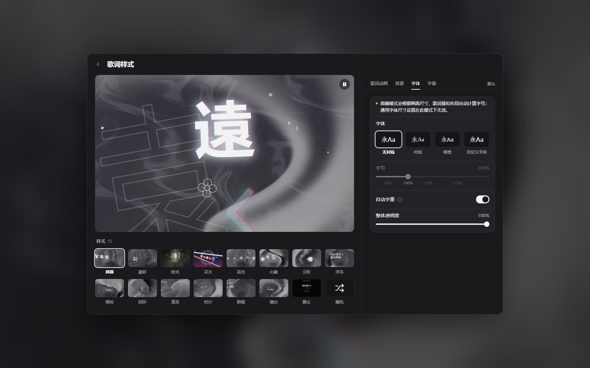
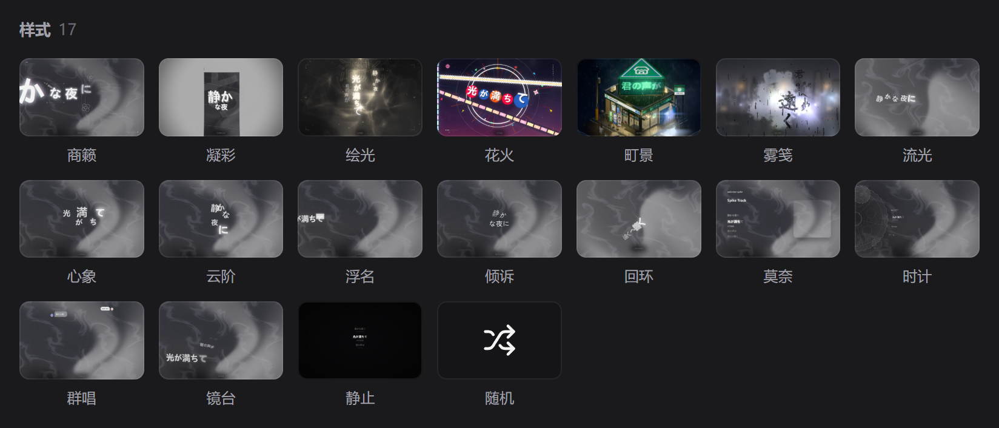

# spw-folia — Salt Player for Windows 的 Folia 歌词可视化插件

把 [Folia](https://github.com/chthollyphile/folia-major) 的歌词可视化带进 **Salt Player for
Windows（SPW）**：迷你播放器「更多」菜单里的 `Folia` 条目打开无边框全屏模式，
17 种歌词样式跟着 SPW 正在播放的音乐实时渲染，也可以把歌词直接叠在桌面上。

[](https://github.com/azkbzxf/spw-folia/releases)
[](LICENSE)
[](#兼容性)
[](https://azkbzxf.github.io/spw-folia/)

**中文** | [English](README.en.md)

<p align="center"></p>

## 这个插件能做什么

- **17 种歌词样式，随手切换** —— 商籁 · 凝彩 · 绘光 · 花火 · 町景 · 雾笺 · 流光 · 心象 · 云阶 ·
  浮名 · 倾诉 · 回环 · 莫奈 · 时计 · 群唱 · 镜台 · 静止。每一种都是 Folia 的原版效果：转场、
  辉光、逐字时间轴、动态背景。勾选几种组成随机池后，每首歌换一种且不连续重复，
  播放面板的骰子按钮还能当场重抽。
- **跟着音乐走** —— 逐字歌词、翻译字幕、播放 / 暂停 / 跳转 / 倍速都与播放器同步，
  画面还会随音乐起伏。
- **播放条可以直接点** —— 底部播放条：播放 / 暂停、上一首 / 下一首、拖动进度、随机 / 循环，
  还能打开播放队列点选切歌。也可以**直接点画面**：中间暂停、左右两侧切歌。
  这一层不挡画面本身的操作 —— 「町景」照常按住拖动转视角、滚轮缩放、右键平移，拖就是拖、点就是点。
- **设置页所见即所得** —— 「歌词样式」窗口左边就是播放页本身的样子（真实歌曲、真实歌词、
  真实背景），拖动任何滑块立刻看到结果。
- **字体与字幕都能换** —— 导入字体包（`.ttf` / `.otf` / `.woff` / `.woff2`，单个 ≤ 50 MB）
  或从系统字体里挑；字重、字号、整体透明度、字幕样式与背景、即将歌词模糊都可调。
- **画面配色跟着封面走** —— 主题、背景与强调色由当前歌曲封面派生，切歌即变。
- **把歌词叠在桌面上** —— 播放页右下角的按钮面板里打开「播放页透明背景」，窗口就变成真正的
  透明窗口，只留歌词与特效浮在桌面或其它窗口之上，适合直播 / OBS 叠加；下一行的「鼠标穿透」
  让你一边放歌词一边照常操作电脑。
- **快捷键随时收回** —— SPW 的「快捷键管理」里有两条可重绑动作：`播放页透明背景：开 / 关`
  （默认 **Ctrl+Alt+G**）与 `播放页透明背景 + 鼠标穿透：开 / 关`（默认 **Ctrl+Alt+Shift+G**）。
  **Ctrl+Alt+B** 用于从透明状态恢复不透明。
- **入口不止一个** —— 迷你播放器「更多 → Folia」、最小化后右键托盘图标都能开关；
  支持多显示器，**Alt + 左键**可跨屏拖动窗口。
- **出问题时能自己查** ——「模组管理 → 配置 → 支持与反馈 → 出现问题」（播放页右上角救生圈按钮
  同效）会逐项检查运行环境，缺什么就提示什么；环境齐全时会打开已预填环境信息与日志的反馈页，
  同时打开日志文件夹并选中日志文件。详见 [排障文档](docs/runtime-requirements.md)。
- **样式小图不用每次重画** —— 「歌词样式」面板的 17 格小图第一次画完会缓存在本机，
  再次打开几乎立刻出图。机器较弱的话，在「配置 → 播放页 → 歌词样式预览动画」关掉动画，
  每格只画简约图案，打开设置会明显更顺。
- **不联网、不上传** —— 没有 HTTP 服务、没有外部请求，数据只在插件与本地辅助进程之间传递；
  只读取播放状态与当前歌曲 / 歌词 / 封面，不写入音乐库。

## 截图

<p align="center">
  
  
</p>
<p align="center">
  
  
</p>
<div align="center"><sub>全屏播放页 · 歌词样式设置页 · 播放页透明背景 · 17 种歌词样式</sub></div>

> 想一次看全？[**宣传站**](https://azkbzxf.github.io/spw-folia/) 有滚动演示、17 种样式大图，
> 以及一段实拍巡览（画面全部由插件真实渲染）。

## 安装与使用

1. **装插件**，两种方式任选：
   - 从 [Releases](https://github.com/azkbzxf/spw-folia/releases) 下载最新的 `.spmod` 文件；
   - 或在 [Steam 创意工坊](https://steamcommunity.com/sharedfiles/filedetails/?id=3825012802)
     订阅（Steam 版会在订阅后自动安装）。
2. SPW → **设置 → 插件 / 创意工坊 → 导入插件**，选择该文件并启用。询问时授予
   **class-transform**（「钩子」）权限 —— 菜单条目需要它；再授予 **key-bindings**（「快捷键」）
   —— 透明快捷键需要它。漏授也可以在插件权限页补授后重启 SPW。
3. 插件管理器提示时**重启 SPW**。
4. 播放歌曲，打开迷你播放器的 **更多**（…）菜单 → **Folia**。

首次运行会打开歌词样式设置窗口，之后直接进入可视化器（右上角 ⚙ 打开设置；ESC 先关设置、
再关窗口）。设置保存在 SPW 的插件数据目录里。

要让歌词悬浮在桌面上：播放页右下角按钮面板 → 打开「播放页透明背景」；需要边放歌词边操作电脑时
再打开「鼠标穿透」，**Ctrl+Alt+B** 恢复不透明。

<p align="center"></p>

## 兼容性

**要求**：Windows 10/11 x64 · **Salt Player for Windows 1.19.0 及以上**（1.19.0 / 1.19.2 /
1.19.3 均已验收）· WebView2 Runtime（Windows 11 内置，Windows 10 需安装 “Microsoft Edge WebView2
Runtime”）· .NET Framework 4.8（Windows 10 1903 起内置）。

完整依赖矩阵与闪退排查见 [docs/runtime-requirements.md](docs/runtime-requirements.md)。

### 已知限制

- **不含智能动感的节拍特效** —— Folia 的 OBS 接口不暴露节拍事件，节拍模型不在它的 web 产物里。
  关闭智能动感时（Folia 默认值），所有样式的渲染与 Folia 一致。设置页已移除所有不会生效的控件，
  保留项清单见 [docs/known-inert-settings.md](docs/known-inert-settings.md)。
- **仅支持 Windows** —— 辅助进程依赖 WebView2 与 Windows 音频接口。
- **跟随 SPW 补丁版本** —— 菜单条目的定位方式在运行时解析，1.19.0 起的补丁版无需重新发版即可用；
  `1.19.0` 以下会明确拒绝注入并记日志。见 [docs/hook-target.md](docs/hook-target.md)。
- 只读取播放状态与当前歌曲 / 歌词 / 封面，不写入音乐库。

## 版本

当前版本 **v0.4.18**（2026-11-04）。每个版本的 `.spmod` 与 SHA-256 校验值都在
[GitHub Releases](https://github.com/azkbzxf/spw-folia/releases)，变更说明随各自的 Release 发布。

v0.4.6 之后的一段时间有过一批只在本地构建、从未发布的版本（v0.4.7 ~ v0.4.12），
它们的改动已全部并入之后的正式版本，因此**不要**去找这些版本的下载。
v0.4.13 发布后当天因一个严重缺陷被**下架**，由 v0.4.14 修复替代。
**下载时请只认 [Releases](https://github.com/azkbzxf/spw-folia/releases) 页面上仍然存在的版本。**

各版本的详细变更见 [docs/release-notes-v0.4.18.md](docs/release-notes-v0.4.18.md) 与
Releases 页面。

## 从源码构建

工具链：JDK 25、Gradle（含 wrapper）、Kotlin、Node 24 + pnpm（设置 UI）、Windows 自带 `csc.exe`
（.NET Framework 4.8，用于原生辅助进程）。无需 .NET SDK，无需 Android SDK。

```bat
:: 1) 插件（Kotlin，官方 SPW 创意工坊 Gradle 插件）
cd spw-folia
gradlew.bat plugin          :: -> build/libs/plugin-dev.spw.folia-<version>.spmod

:: 2) 原生辅助进程（C# + WebView2）
cd ..\poc\webview\host
bash build.sh               :: -> build/spw-folia-host.exe (+ WebView2 dlls)

:: 3) 设置 UI（React）
cd ..\..\settings-ui
pnpm install && pnpm build  :: -> dist/settings-ui.js

:: 4) 组装可分发 .spmod
bash packaging/build-package.sh
python packaging/tools/assemble-release.py ^
    --spmod spw-folia/build/libs/plugin-dev.spw.folia-<version>.spmod ^
    --staging packaging --out dist/release --name spw-folia-<version>.spmod
```

`<version>` 取当前构建的插件版本号（`build.gradle.kts` 的 `version`、
`PluginVersion` 与 `FoliaPlugin.PLUGIN_VERSION` 三处必须一致）。

发布前请跑 `node packaging/tools/verify-all.mjs`。完整的打包流水线、payload 清单、大小预算与
发布检查表见 [docs/release.md](docs/release.md)。

## 文档

面向使用者：[运行环境与排障](docs/runtime-requirements.md) ·
[自检与日志](docs/logging-and-diagnostics.md) · [设置项生效情况](docs/known-inert-settings.md)

面向维护者：[架构](docs/architecture.md) · [通信协议](docs/protocol.md) ·
[原生宿主](docs/host-app.md) · [音频与时间轴](docs/audio-timeline.md) ·
[设置 UI](docs/settings-ui-impl.md) · [透明窗口机制](docs/live-transparency.md) ·
[Hook 机制](docs/hook-target.md) · [上游 Folia 同步](docs/upstream-sync.md) ·
[开发陷阱与纪律](docs/lessons.md) · [Folia 复刻规格](docs/folia-spec/) ·
[打包发布](docs/release.md) · [许可](docs/licensing.md)

## 项目地址与反馈

- [GitHub 仓库](https://github.com/azkbzxf/spw-folia) —— 源码、文档、
  [Releases](https://github.com/azkbzxf/spw-folia/releases) 与
  [Issues](https://github.com/azkbzxf/spw-folia/issues)。
- [宣传站](https://azkbzxf.github.io/spw-folia/) —— 滚动演示、17 种样式大图与实拍巡览。
- 交流群：**1075038382**。
- 反馈问题时请附上 SPW 版本、插件版本与复现步骤。

## 致谢

- [Folia](https://github.com/chthollyphile/folia-major)，作者 chthollyphile（AGPL-3.0）——
  可视化器、设置界面与 web 产物都来自 Folia 的工作（v0.7.25）。
- [Salt Player for Windows](https://saltplayer.com/) 创意工坊插件 API，作者 Moriafly。
- [spw-island（Dynamic Lyrics Island for SPW）](https://github.com/gaboron/spw-island) ——
  仅作为行为参考（GPL-3.0），未复制任何代码。
- Microsoft Edge WebView2 SDK、.NET Framework、Kotlin/Compose、React/Vite。

## 许可

AGPL-3.0-or-later。与 Folia、Salt Player 均无隶属关系；本仓库包含 Folia 的衍生作品，分发时希望
它有用，但不提供任何担保。见 [LICENSE](LICENSE)、[THIRD_PARTY_NOTICES.md](THIRD_PARTY_NOTICES.md)
以及 [docs/licensing.md](docs/licensing.md) 中的源码提供说明。
