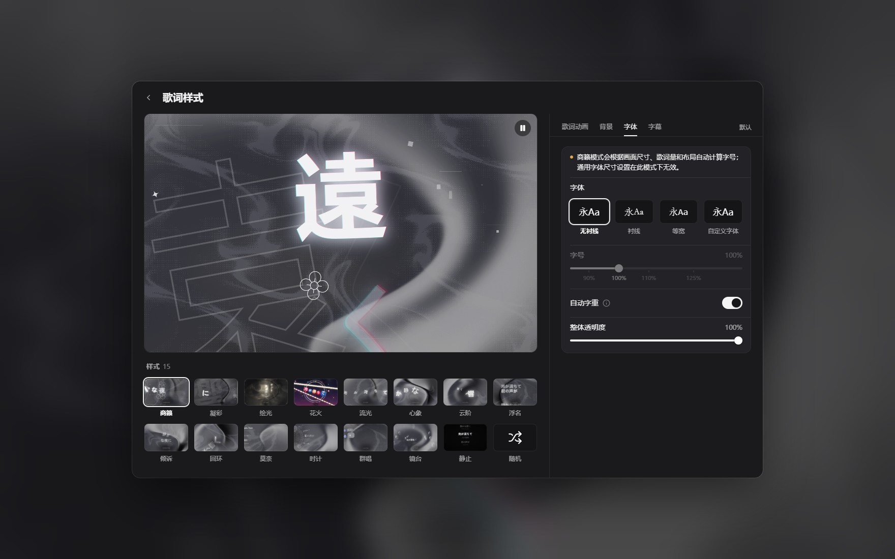

# spw-folia — Salt Player for Windows 的 Folia 歌词可视化插件

把 [Folia](https://github.com/chthollyphile/folia-major) 的歌词可视化带进 **Salt Player for
Windows（SPW）**：迷你播放器「更多」菜单里的 `Folia` 条目打开无边框全屏模式，直接运行 Folia
**自己的**渲染代码（全部 15 种歌词样式），由 SPW 正在播放的音乐驱动；桌面透明叠加、逐帧镜像的
设置页与封面取色也一应俱全。

[](https://github.com/azkbzxf/spw-folia/releases)
[](LICENSE)
[](#兼容性)
[](https://azkbzxf.github.io/spw-folia/)

**中文** | [English](README.en.md)

<p align="center"></p>

## 功能介绍

- **跑的是真 Folia，不是仿制** —— 插件内嵌 Folia 0.7.22 的生产级 OBS 浏览器源产物，15 种样式
  全部是 Folia 原始代码：动态、辉光、逐字时间轴、背景与转场都与 Folia 像素级一致。
- **15 种样式，随手切换** —— 商籁 · 凝彩 · 绘光 · 花火 · 流光 · 心象 · 云阶 · 浮名 · 倾诉 · 回环 ·
  莫奈 · 时计 · 群唱 · 镜台 · 静止；勾选几种组成随机池后，每首歌换一种且不连续重复，播放面板的
  骰子按钮可当场重抽。
- **与播放器完全同步** —— 逐字歌词、翻译字幕、播放 / 暂停 / 跳转 / 倍速；另有 WASAPI 环回音频
  分析，让画面跟着音乐起伏。
- **播放条可直接操作** —— 底部播放条按钮全部可点：播放 / 暂停、上一首 / 下一首、进度、随机 /
  循环模式，还能打开播放队列并点选切歌。
- **设置页与 Folia 1:1** ——「歌词样式」窗口复用 Folia 自己的 React 组件；左侧大预览**逐帧镜像
  播放页**：同一个同源 iframe 渲染器、同一份播放页 config、同一条真实时钟，连「播放页透明背景」的
  透明效果也真实呈现；拖动任何滑块立刻看到结果。
- **自定义字体与字幕** —— 导入字体包（`.ttf` / `.otf` / `.woff` / `.woff2`，单个 ≤ 50 MB）或从
  系统字体里挑选；字重、字号、自动字重、整体透明度、字幕样式与背景、即将歌词模糊等都可调。
- **封面取色** —— 主题、背景与强调色由当前歌曲封面派生，切歌即变。
- **桌面透明叠加** —— 全屏页右下角的圆钮面板可开关「播放页透明背景」：窗口变成真正的透明窗口，
  只留歌词与特效叠在桌面或其它窗口之上，适合直播 / OBS 叠加；第二行「鼠标穿透」让你一边放歌词
  一边照常操作电脑，**Ctrl+Alt+B** 随时恢复不透明。
- **透明背景快捷键** —— SPW 的「快捷键管理」里新增两条可重绑动作：`播放页透明背景：开 / 关`
  （默认 **Ctrl+Alt+G**）与 `播放页透明背景 + 鼠标穿透：开 / 关`（默认 **Ctrl+Alt+Shift+G**）。
  窗口开着时按下立刻生效；打开该动作的「全局」开关后，Folia 窗口聚焦时也能用。
- **入口与多屏** —— 迷你播放器「更多 → Folia」、最小化后右键托盘图标都能开 / 关；适配多显示器，
  **Alt + 左键**可跨屏拖动，呼出快捷键可自定义；打开时还有封面取色的过渡动画（默认关闭）。
- **不联网、不上传** —— 没有 HTTP 服务、没有外部请求，数据只在插件与本地辅助进程之间经
  stdin/stdout 传递；只读取播放状态与当前歌曲 / 歌词 / 封面，不写入音乐库。

## 截图

<p align="center">
  
  
</p>
<p align="center">
  
  
</p>
<div align="center"><sub>全屏播放页 · Folia 设置页 · 播放页透明背景 · 15 种歌词样式（样式图为 v0.3.x 拍摄，尚缺「花火」）</sub></div>

> 想一次看全？[**宣传站**](https://azkbzxf.github.io/spw-folia/) 有滚动演示、15 种样式大图，
> 以及 [一段 48 秒的实拍巡览](https://azkbzxf.github.io/spw-folia/#film)（画面全部由插件真实渲染）。

## 使用方法

1. 从 [Releases](https://github.com/azkbzxf/spw-folia/releases) 下载 `spw-folia-0.4.1-preview.1.spmod`；
   也可以直接在 [Steam 创意工坊](https://steamcommunity.com/sharedfiles/filedetails/?id=3825012802)
   订阅（Steam 版会在订阅后自动安装）。
2. SPW → **设置 → 插件 / 创意工坊 → 导入插件**，选择该文件并启用；询问时授予 **class-transform**
   （「钩子」）权限——菜单 hook 需要它；再授予 **key-bindings**（「快捷键」）——透明快捷键需要它
   （漏了也可以在插件权限页补授后重启 SPW）。
3. 插件管理器提示时重启 SPW。
4. 播放歌曲，打开迷你播放器的 **更多**（…）菜单 → **Folia**。

首次运行会打开 Folia 设置窗口，之后直接进入可视化器（⚙ 打开设置；ESC 先关设置、再关窗口）。
设置保存在 SPW 的插件数据目录中。

要让歌词悬浮在桌面上：全屏页右下角圆钮面板 → 打开「播放页透明背景」；需要边放歌词边操作电脑时
再打开「鼠标穿透」，**Ctrl+Alt+B** 恢复不透明。SPW 的「快捷键管理」里还能把这两个开关绑到自己的
键位（默认 **Ctrl+Alt+G** / **Ctrl+Alt+Shift+G**）。

<p align="center"></p>

## 兼容性

**要求**：Windows 10/11 x64 · **Salt Player for Windows 1.19.0 及以上**（1.19.0 / 1.19.2 均已
验收）· WebView2 Runtime（Windows 11 内置，Windows 10 需安装 “Microsoft Edge WebView2
Runtime”）· .NET Framework 4.8（Windows 10 1903 起内置）。完整依赖矩阵与闪退排查见
[docs/runtime-requirements.md](docs/runtime-requirements.md)。

**权限**：启用插件时需要授予 **class-transform**（菜单钩子）与 **key-bindings**（透明快捷键）；
漏授可在插件的权限页补授后重启 SPW。

### 已知限制

- **不含智能动感的节拍特效** —— Folia 的 OBS 接口不暴露节拍事件，节拍模型（约 133 MB）跑在
  Folia 的 Electron 主进程里，不在其 web bundle 中。关闭智能动感时（Folia 默认值），所有样式的
  渲染与 Folia 完全一致。设置页已移除所有不会生效的控件，保留项清单见
  [docs/known-inert-settings.md](docs/known-inert-settings.md)。
- **仅支持 Windows** —— 辅助进程依赖 WebView2 + Windows WASAPI。
- **跟随 SPW 小版本升级** —— 菜单 hook 的宿主类名在运行时解析（已知版本走内置映射表，未知版本
  扫描宿主 jar 的结构后缓存），因此 1.19.0 起的补丁版（1.19.2 等）无需重新发版即可用；
  `1.19.0` 以下会明确拒绝注入并记日志（见 [docs/hook-target.md](docs/hook-target.md)）。
- 只读取播放状态与当前歌曲 / 歌词 / 封面，不写入音乐库。

## 版本

当前 **v0.4.1-preview.1**。每个版本的 `.spmod` 与 SHA-256 校验值都在
[GitHub Releases](https://github.com/azkbzxf/spw-folia/releases)；逐版变更与验收证据归档在
[docs/archive/](docs/archive/)，仓库内不再重复。

v0.3.1 的发布产物已在 Windows 11 + 真实 SPW **1.19.0 与 1.19.2** 上完成端到端验收：菜单条目 →
全屏渲染、0 页面错误、0 外部网络请求、16 分钟长稳、设置持久化、无残留辅助进程。v0.4.0 把样式
扩到 **15 种**（新增「花火」）并加入随机样式池、自定义字体与托盘入口；v0.4.1 让设置页预览变成
播放页的真实镜像（真实歌曲/歌词/背景/透明状态 + 真实时钟），并移除「预览文本」选项。

## 从源码构建

工具链：JDK 25、Gradle 9.8（含 wrapper）、Kotlin 2.4.20、Node 24 + pnpm（设置 UI）、Windows 自带
`csc.exe`（.NET Framework 4.8，用于原生辅助进程）。无需 .NET SDK，无需 Android SDK。

```bat
:: 1) 插件（Kotlin，官方 SPW 创意工坊 Gradle 插件）
cd spw-folia
gradlew.bat plugin          :: -> build/libs/plugin-dev.spw.folia-0.4.1.spmod

:: 2) 原生辅助进程（C# + WebView2）
cd ..\poc\webview\host
bash build.sh               :: -> build/spw-folia-host.exe (+ WebView2 dlls)

:: 3) 设置 UI（React）
cd ..\..\settings-ui
pnpm install && pnpm build  :: -> dist/settings-ui.js

:: 4) 组装可分发 .spmod（插件 classes + 暂存 web bundle + 原生进程 + 许可证）
bash packaging/build-package.sh     :: 暂存 packaging/{web,native,licenses} + SHA256SUMS
python packaging/tools/assemble-release.py ^
    --spmod spw-folia/build/libs/plugin-dev.spw.folia-0.4.1.spmod ^
    --staging packaging --out dist/release --name spw-folia-0.4.1-preview.1.spmod
```

完整的打包流水线、payload 清单、大小预算与发布检查表见 [docs/release.md](docs/release.md)。

## 文档

[架构](docs/architecture.md) · [通信协议](docs/protocol.md) · [原生宿主](docs/host-app.md) ·
[音频与时间轴](docs/audio-timeline.md) · [设置 UI](docs/settings-ui-impl.md) ·
[透明窗口机制](docs/live-transparency.md) · [Folia 复刻规格](docs/folia-spec/) ·
[打包发布](docs/release.md) · [运行环境与排障](docs/runtime-requirements.md) ·
[许可](docs/licensing.md)

## 项目地址与反馈

- [GitHub 仓库](https://github.com/azkbzxf/spw-folia) —— 源码、文档、[Releases](https://github.com/azkbzxf/spw-folia/releases)
  与 [Issues](https://github.com/azkbzxf/spw-folia/issues)。
- [宣传站](https://azkbzxf.github.io/spw-folia/) —— 滚动演示、15 种样式大图与 48 秒实拍巡览。
- 交流群：**1075038382**。
- 反馈问题时请附上 SPW 版本、插件版本与复现步骤。

## 致谢

- [Folia](https://github.com/chthollyphile/folia-major)，作者 chthollyphile（AGPL-3.0）——整个
  可视化器、设置 UI 与 web bundle 都来自 Folia 的工作（v0.7.22）。
- [Salt Player for Windows](https://saltplayer.com/) 创意工坊插件 API，作者 Moriafly。
- [spw-island（Dynamic Lyrics Island for SPW）](https://github.com/gaboron/spw-island) ——
  仅作为行为参考（GPL-3.0）；未复制任何代码。
- Microsoft Edge WebView2 SDK、.NET Framework、Kotlin/Compose、React/Vite。

## 许可

AGPL-3.0-or-later。与 Folia、Salt Player 均无隶属关系；本仓库包含 Folia 的衍生作品，分发时希望
它有用，但不提供任何担保。见 [LICENSE](LICENSE)、[THIRD_PARTY_NOTICES.md](THIRD_PARTY_NOTICES.md)
以及 [docs/licensing.md](docs/licensing.md) 中的源码提供说明。
